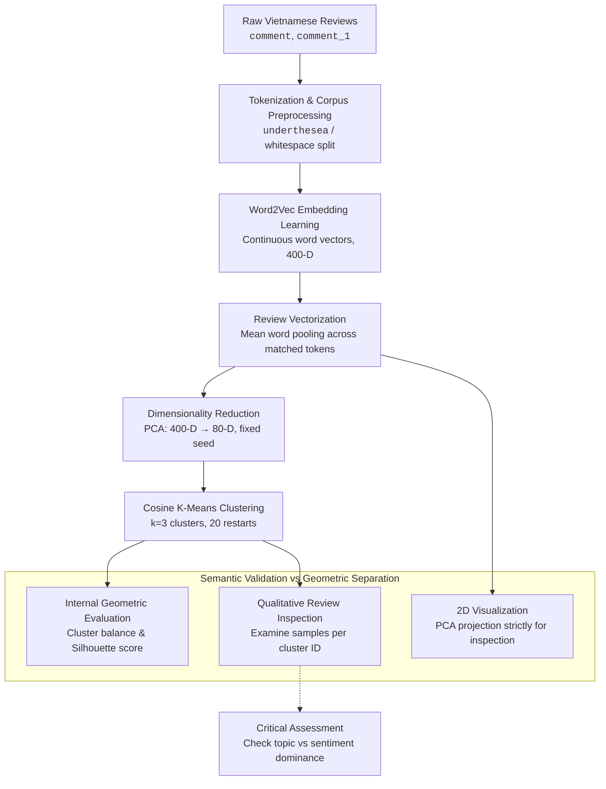

# Unsupervised Sentiment Analysis for Vietnamese

Unsupervised sentiment analysis of Vietnamese customer reviews using **Word2Vec**, **Sentence2Vec**, **PCA**, and **K-means clustering**. The pipeline learns sentiment polarity directly from unlabeled text — no annotated training data required.


> Visualization of the K-means result (3 clusters) projected onto 2 dimensions via PCA. Red: Negative, Green: Neutral, Blue: Positive.

## Table of Contents
- [Overview](#overview)
- [Pipeline](#pipeline)
- [Approach](#approach)
- [Getting Started](#getting-started)
  - [Prerequisites](#prerequisites)
  - [Installation](#installation)
  - [Usage](#usage)
- [Configuration](#configuration)
- [Results](#results)
- [Project Structure](#project-structure)
- [Future Work](#future-work)
- [License](#license)

## Overview

This project performs **sentiment analysis for Vietnamese** without relying on labeled data or an external sentiment lexicon. Instead, it:

1. Learns Vietnamese word embeddings from raw product reviews using **Word2Vec**.
2. Represents each review (sentence) as a fixed-length vector by averaging its word vectors — a **Sentence2Vec** approach.
3. Reduces the dimensionality of the sentence vectors with **PCA**.
4. Groups the sentences into sentiment categories using **K-means clustering** with cosine distance.

The result is a fully unsupervised classification of reviews into **Negative**, **Neutral**, and **Positive** sentiment.

## Pipeline

```text
Raw Vietnamese reviews
        │
        ▼
 Word2Vec (word embeddings)
        │
        ▼
 Sentence2Vec (mean of word vectors)
        │
        ▼
 PCA (dimensionality reduction)
        │
        ▼
 K-means clustering (cosine distance)
        │
        ▼
 Sentiment labels: Negative / Neutral / Positive
```

## Approach

### Word2Vec
A Word2Vec model (skip-gram style, applied with the Gensim library) is trained on tokenized Vietnamese reviews. It captures semantic relationships between words, e.g. the nearest neighbors of *tốt* ("good") include *rất_đẹp*, *rất_ưng*, *rất_thích*, *rất_tốt* — all strongly positive words, confirming that sentiment is encoded in the learned embeddings.

| Attribute   | Value  |
|-------------|--------|
| Vector size | 400    |
| Window      | 10     |
| Epochs      | 35     |
| Min count   | 5      |
| Seed        | 567    |

### Sentence2Vec
Each review is tokenized with the `underthesea` tokenizer, its word vectors are fetched from the Word2Vec model, and the sentence vector is computed as the **mean of the (summed) word vectors**, normalized by the vector size. A cosine-similarity method is provided to compare sentences.

### PCA
The high-dimensional (400-D) sentence vectors are projected down to 80 dimensions with PCA to improve clustering efficiency and reduce noise.

### K-means Clustering
K-means clustering is applied with **cosine distance**, normalization enabled, repeated across 20 attempts, with empty clusters disallowed. `NUM_CLUSTERS = 3` maps directly onto the three sentiment classes.
## Research Question

> Can unsupervised text representations and clustering recover sentiment-related structure without using sentiment labels during fitting?

Clustering optimizes similarity in a representation space, not sentiment. A cluster can instead reflect topic, vocabulary, writing style, text length, or other properties. Cluster separation is therefore not evidence by itself that sentiment has been recovered.

## Workflow



## Current Notebook

The notebook is an initial prototype. Its current workflow trains Word2Vec embeddings on review text, constructs review vectors, applies PCA, and clusters the vectors with K-means using cosine distance. It sets the number of clusters to three, but this is a modelling choice, not evidence that the data contains three sentiment classes.

The notebook also projects vectors to two dimensions for visualization. The plotted coordinates are only a projection and cannot validate cluster meaning. Cluster IDs are arbitrary and must not be called negative, neutral, or positive without independent evaluation.

The current implementation and its outputs have not yet been validated. In particular, preprocessing and review-vector construction should be checked before interpreting any clusters.

## Data

The dataset is stored in [`data.xlsx`](data.xlsx) and is included directly in this repository.

| Property | Detail |
|---|---|
| File | `data.xlsx` |
| Samples | 23,927 reviews |
| Language | Vietnamese |

### Columns

| Column | Type | Description |
|---|---|---|
| `comment` | text | Review content |
| `Sentiment` | label | Sentiment label: `positive`, `negative`, `neutral` (note: one row contains a typo `negatvie`) |
| `phan_loai` | label | Product/service category: `thoi_trang` (fashion), `shop`, `khac` (other), `chung` (general), `cong_nghe` (technology), `bach_hoa` (grocery), `gia_dung` (household), `my_pham` (cosmetics), `giai_tri` (entertainment), and others |
| `Quality` | binary | Whether the review mentions quality (1) or not (0) |
| `Price` | binary | Whether the review mentions price (1) or not (0) |

### Sentiment distribution

| Label | Count |
|---|---|
| positive | 14,571 |
| negative | 5,992 |
| neutral | 3,363 |

### Usage note

Sentiment labels were not used during representation learning or clustering. They are retained for post-hoc evaluation of whether the discovered clusters align with sentiment polarity. The `phan_loai`, `Quality`, and `Price` columns are likewise available for post-hoc analysis of topic-sentiment entanglement.

## Interpretation and Limitations

- The notebook does not currently use sentiment labels or measure cluster agreement with sentiment.
- Internal clustering metrics and plots can describe geometric structure, but cannot establish sentiment validity.
- Topic, vocabulary, writing style, and other signals may dominate polarity.
- Ground-truth labels (`Sentiment`, `phan_loai`, `Quality`, `Price`) are available in the dataset but were withheld from representation learning and clustering; they can be used for post-hoc evaluation only.

This repository is an exploratory prototype, not a validated sentiment classifier. Any sentiment interpretation should be treated as a hypothesis until supported by independent evidence.

## Getting Started

### Prerequisites
- Python 3.7+
- [Jupyter Notebook](https://jupyter.org/)
- An Excel file of Vietnamese product reviews with a `comment` column (and a `comment_1` normalized column), loaded as `data`.

- A Python environment with the packages listed in `requirement.txt` (the notebook may require additional packages for data loading, e.g., `openpyxl` for reading `.xlsx` files).
- [Jupyter Notebook](https://jupyter.org/).

### Installation

```bash
pip install -r requirement.txt
```

### Usage

Open and run the notebook cell-by-cell:
The dataset `data.xlsx` is already present in the repository. Open and run the notebook cell-by-cell:

```bash
jupyter notebook Unsupervised_sentiment_analysis.ipynb
```

The notebook walks through the full pipeline: importing the data, training Word2Vec, building sentence vectors, reducing dimensions with PCA, clustering with K-means, and finally plotting the results with the sentiment labels.

> **Note:** The `w2v.model` artifact is produced by training and then re-loaded via the `Sentence2Vec` class.

## Configuration

Key hyperparameters are defined at the top of the notebook:

| Constant        | Value | Description                                        |
|-----------------|-------|----------------------------------------------------|
| `W2V_SIZE`      | 400   | Word vector dimensionality                         |
| `W2V_WINDOW`    | 10    | Maximum distance between current and predicted word |
| `W2V_EPOCH`     | 35    | Number of training epochs                          |
| `W2V_MIN_COUNT` | 5     | Ignores tokens with frequency lower than this       |
| `SEED`          | 567   | Random seed for reproducibility                    |
| `NUM_CLUSTERS`  | 3     | Number of sentiment clusters                       |
| `iteration`     | 20    | K-means repeated restarts                          |

## Results

After clustering, each review is assigned a label (0, 1, or 2):
- **Label 0** — Negative (e.g., *"vải thô, không mềm, bị bạc"*)
- **Label 1** — Neutral (e.g., *"Size không chính xác, áo quá nóng"*)
- **Label 2** — Positive (e.g., *"Vải dày mịn áo y hình rất đẹp"*)

The final scatter plot (projected to 2D) visually separates the three sentiment groups, demonstrating that unsupervised clustering recovers sentiment structure from raw Vietnamese text.

## Project Structure

```text
.
├── Unsupervised_sentiment_analysis.ipynb   # Exploratory notebook with baseline workflow
├── data.xlsx                               # Vietnamese review dataset (23,927 samples)
├── requirement.txt                         # Python dependencies
└── README.md
```

## Future Work

- Document the dataset source, licence, and preprocessing steps in detail.
- Audit and correct the existing vectorization workflow before interpreting results.
- Evaluate cluster stability across repeated runs and modelling choices.
- Compare clusters with held-out sentiment labels, if available, or a manually annotated subset.
- Inspect representative and contradictory reviews to assess topic-sentiment entanglement.
- Compare a small number of motivated text representations and clustering methods.

## License

This project is licensed under the [MIT License](LICENSE).
