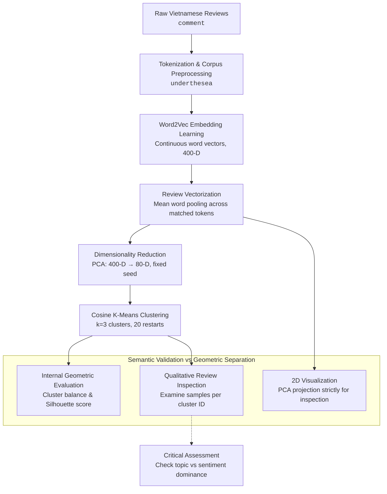

# Unsupervised Sentiment Analysis for Vietnamese

An exploratory study of Vietnamese customer reviews using **Word2Vec**, **Sentence2Vec**, **PCA**, and **K-means clustering**. The pipeline learns representations and clusters without using sentiment labels during fitting; whether the resulting clusters actually capture sentiment is the research question, not an assumption.


> Visualization of the K-means result (3 clusters) projected onto 2 dimensions via PCA. Red: Cluster 0, Green: Cluster 1, Blue: Cluster 2. Cluster IDs are arbitrary; mapping them to sentiment requires independent evaluation (see [Results](#results)).

## Why This Project Was Born

This project was made during my internship at **Stech VN**, an AI startup company. My responsibility was to support the development of a **Machine Learning Autonomous Market Research Pipeline using Sentiment Analysis**. One of the main tasks assigned to me was to label product review comments on e-commerce platforms, as the first step of the machine learning pipeline. I immediately saw two problems with this manual labeling approach:

1) It was very **time-consuming** and **inefficient**. We estimated that we would need approximately **300,000 labeled data points** to train an acceptable supervised model, which would take months of labeling and cross-checking.
2) Human annotators disagree, and their labels carry that **noise and bias**. Having multiple annotators label each review to measure and reduce that disagreement would roughly double the work and time required.

Labeled sentiment data is expensive to produce, and far less of it exists for Vietnamese than for English. Customer reviews, on the other hand, are plentiful and cheap to collect. This project started from a simple question: could the structure of those reviews alone reveal how customers feel, without anyone annotating them first?

The project now treats that gap as its research question. Instead of claiming an unsupervised sentiment classifier, it examines when sentiment-related structure emerges, when other signals dominate, and what evidence is needed before a cluster can be called a sentiment.

---

## Table of Contents

- [Why This Project Was Born](#why-this-project-was-born)
- [Overview](#overview)
- [Approach](#approach)
- [Research Question](#research-question)
- [Workflow](#workflow)
- [Current Notebook](#current-notebook)
- [Data](#data)
- [Interpretation and Limitations](#interpretation-and-limitations)
- [Getting Started](#getting-started)
  - [Prerequisites](#prerequisites)
  - [Installation](#installation)
  - [Usage](#usage)
- [Configuration](#configuration)
- [Results](#results)
- [Project Structure](#project-structure)
- [Future Work](#future-work)
- [License](#license)

## Overview

This project performs **unsupervised exploration of Vietnamese customer reviews** without relying on labeled data or an external sentiment lexicon during fitting. Instead, it:

1. Learns Vietnamese word embeddings from raw product reviews using **Word2Vec**.
2. Represents each review (sentence) as a fixed-length vector by averaging its word vectors — a **Sentence2Vec** approach.
3. Reduces the dimensionality of the sentence vectors with **PCA**.
4. Groups the sentences into clusters using **K-means clustering** with cosine distance.

Sentiment labels are never used during fitting. Whether the resulting clusters correspond to **negative**, **neutral**, and **positive** sentiment is an open question, evaluated post-hoc against the held-out labels (see [Interpretation and Limitations](#interpretation-and-limitations)).

## Approach

### Word2Vec

A Word2Vec model (skip-gram style, applied with the Gensim library) is trained on tokenized Vietnamese reviews. It captures semantic relationships between words, e.g. the nearest neighbors of *tốt* ("good") include *rất_đẹp*, *rất_ưng*, *rất_thích*, *rất_tốt* — all strongly positive words, suggesting that sentiment-related information is present in the learned embeddings. This is anecdotal evidence only: nearest-neighbor inspection says nothing about whether the downstream clusters capture sentiment.

| Attribute   | Value |
| ----------- | ----- |
| Vector size | 400   |
| Window      | 10    |
| Epochs      | 35    |
| Min count   | 5     |
| Seed        | 567   |

### Sentence2Vec

Each review is tokenized with the `underthesea` tokenizer, its word vectors are fetched from the Word2Vec model, and the sentence vector is computed as the **mean of its word vectors** (the sum divided by the number of tokens found in the vocabulary; tokens missing from the vocabulary are skipped, and a review with no matched tokens yields a zero vector). A cosine-similarity method is provided to compare sentences.

### PCA

The high-dimensional (400-D) sentence vectors are projected down to 80 dimensions with PCA to improve clustering efficiency and reduce noise.

### K-means Clustering

K-means clustering is applied with **cosine distance**, normalization enabled, repeated across 20 attempts, with empty clusters disallowed. `NUM_CLUSTERS = 3` is a modeling choice motivated by the three-class label scheme; it is not evidence that the data contains three sentiment classes.

## Research Question

> Can unsupervised text representations and clustering recover sentiment-related structure without using sentiment labels during fitting?

Clustering optimizes similarity in a representation space, not sentiment. A cluster can instead reflect topic, vocabulary, writing style, text length, or other properties. Cluster separation is therefore not evidence by itself that sentiment has been recovered.

## Workflow



## Current Notebook

The notebook is an initial prototype. Its current workflow trains Word2Vec embeddings on review text, constructs review vectors, applies PCA, and clusters the vectors with K-means using cosine distance. It sets the number of clusters to three, but this is a modeling choice, not evidence that the data contains three sentiment classes.

The notebook also projects vectors to two dimensions for visualization. The plotted coordinates are only a projection and cannot validate cluster meaning. Cluster IDs are arbitrary and must not be called negative, neutral, or positive without independent evaluation.

The current implementation and its outputs have not yet been validated. In particular, preprocessing and review-vector construction should be checked before interpreting any clusters.

## Data

The dataset is stored in [`data.xlsx`](data.xlsx) and is included directly in this repository.

| Property | Detail         |
| -------- | -------------- |
| File     | `data.xlsx`  |
| Samples  | 23,927 reviews |
| Language | Vietnamese     |

### Columns

| Column        | Type   | Description                                                                                                                                                                                                                                          |
| ------------- | ------ | ---------------------------------------------------------------------------------------------------------------------------------------------------------------------------------------------------------------------------------------------------- |
| `comment`   | text   | Review content                                                                                                                                                                                                                                       |
| `Sentiment` | label  | Sentiment label: `positive`, `negative`, `neutral` (note: one row contains a typo `negatvie`)                                                                                                                                                |
| `phan_loai` | label  | Product/service category: `thoi_trang` (fashion), `shop`, `khac` (other), `chung` (general), `cong_nghe` (technology), `bach_hoa` (grocery), `gia_dung` (household), `my_pham` (cosmetics), `giai_tri` (entertainment), and others |
| `Quality`   | binary | Whether the review mentions quality (1) or not (0)                                                                                                                                                                                                   |
| `Price`     | binary | Whether the review mentions price (1) or not (0)                                                                                                                                                                                                     |

### Sentiment distribution

| Label    | Count  |
| -------- | ------ |
| positive | 14,571 |
| negative | 5,992  |
| neutral  | 3,363  |

One additional row carries the typo `negatvie` (see [Columns](#columns)), so the counts above sum to 23,926 of the 23,927 samples.

### Usage note

Sentiment labels were not used during representation learning or clustering. They are retained for post-hoc evaluation of whether the discovered clusters align with sentiment polarity. The `phan_loai`, `Quality`, and `Price` columns are likewise available for post-hoc analysis of topic-sentiment entanglement.

## Interpretation and Limitations

- The notebook never uses sentiment labels during fitting; its Evaluation section measures cluster–label agreement post-hoc (adjusted Rand index) alongside an internal geometric metric (silhouette score).
- Internal clustering metrics and plots can describe geometric structure, but cannot establish sentiment validity.
- Topic, vocabulary, writing style, and other signals may dominate polarity.
- Ground-truth labels (`Sentiment`, `phan_loai`, `Quality`, `Price`) are available in the dataset but were withheld from representation learning and clustering; they can be used for post-hoc evaluation only.

This repository is an exploratory prototype, not a validated sentiment classifier. Any sentiment interpretation should be treated as a hypothesis until supported by independent evidence.

## Getting Started

### Prerequisites

- Python 3.7+
- [Jupyter Notebook](https://jupyter.org/)
- The included `data.xlsx` file of Vietnamese product reviews with a `comment` column, loaded as `df_new`.
- A Python environment with the packages listed in `requirement.txt`, plus `openpyxl` for reading `.xlsx` files.

### Installation

```bash
pip install -r requirement.txt
```

### Usage

The dataset `data.xlsx` is already present in the repository. Open and run the notebook cell-by-cell:

```bash
jupyter notebook Unsupervised_sentiment_analysis.ipynb
```

The notebook walks through the full pipeline: importing the data, training Word2Vec, building sentence vectors, reducing dimensions with PCA, clustering with K-means, computing evaluation metrics (silhouette score and adjusted Rand index against the held-out labels), and plotting the clusters in 2D.

> **Note:** The `w2v.model` artifact is produced by training and then re-loaded via the `Sentence2Vec` class.

## Configuration

Key hyperparameters are defined at the top of the notebook:

| Constant          | Value | Description                                         |
| ----------------- | ----- | --------------------------------------------------- |
| `W2V_SIZE`      | 400   | Word vector dimensionality                          |
| `W2V_WINDOW`    | 10    | Maximum distance between current and predicted word |
| `W2V_EPOCH`     | 35    | Number of training epochs                           |
| `W2V_MIN_COUNT` | 5     | Ignores tokens with frequency lower than this       |
| `SEED`          | 567   | Random seed for reproducibility                     |
| `NUM_CLUSTERS`  | 3     | Number of K-means clusters (modeling choice)        |
| `iteration`     | 20    | K-means repeated restarts                           |

## Results

After clustering, each review is assigned a cluster ID (0, 1, or 2). Cluster IDs are arbitrary and not stable across runs; naming them requires independent evidence. Sample reviews from one run:

- **Cluster 0** — e.g., *"vải thô, không mềm, bị bạc"* ("rough fabric, not soft, faded")
- **Cluster 1** — e.g., *"Size không chính xác, áo quá nóng"* ("inaccurate sizing, the shirt is too hot")
- **Cluster 2** — e.g., *"Vải dày mịn áo y hình rất đẹp"* ("thick, fine fabric; the shirt looks exactly like the picture, very nice")

Qualitatively, clusters 0 and 2 look predominantly negative and positive, while cluster 1 mixes complaints with other content — an early hint that topic and style compete with polarity, and a reminder that a cluster's dominant impression is not the same as validated sentiment structure.

The 2D scatter plot shows geometric separation of the clusters only; it cannot validate cluster meaning. Quantitative evidence is computed in the notebook's Evaluation section: the silhouette score (geometric separation) and the adjusted Rand index (agreement with the held-out `Sentiment` labels). Any sentiment interpretation of a cluster should be justified against that evidence, not against the plot.

## Project Structure

```text
.
├── Unsupervised_sentiment_analysis.ipynb   # Exploratory notebook with baseline workflow
├── data.xlsx                               # Vietnamese review dataset (23,927 samples)
├── requirement.txt                         # Python dependencies
└── README.md
```

## Future Work

- Document the dataset source, license, and preprocessing steps in detail.
- Audit and correct the existing vectorization workflow before interpreting results.
- Evaluate cluster stability across repeated runs and modeling choices.
- Report and interpret the adjusted Rand index between clusters and the held-out sentiment labels across repeated runs and representations.
- Inspect representative and contradictory reviews to assess topic-sentiment entanglement.
- Compare a small number of motivated text representations and clustering methods.

## License

This project is licensed under the [MIT License](LICENSE).
